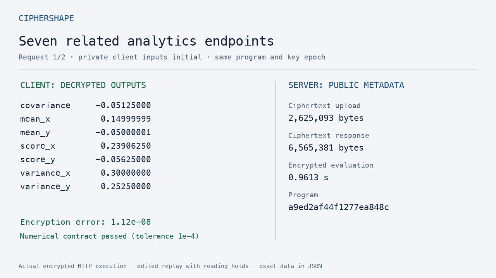

# CipherShape

**Compile small numerical endpoints that run on encrypted client inputs.**

[Watch the 31-second recorded execution replay](assets/demo/ciphershape-demo.mp4)
or inspect the [raw terminal recording](assets/demo/demo.cast).



The client generates keys, checks input ranges and encrypts. A separate server
process evaluates an OpenFHE CKKS plan using ciphertexts and public evaluation
keys. The client decrypts the permitted scalar outputs. There is no plaintext
fallback.

Two applications use the same typed graph language:

- **Analytics:** means, population variances, covariance and public linear scores
  for two eight-element vectors.
- **Public model inference:** a four-feature linear model trained on original
  synthetic examples. Model weights are public; feature values are private.

CKKS is approximate homomorphic encryption: it permits arithmetic on encrypted
numbers, with numerical error. This is a bounded, leveled computation, with no
bootstrapping or arbitrary-depth execution. The security target is an
honest-but-curious server following the protocol. Read the
[security contract](docs/security.md) before using private data.

## Build and run

Requires Python 3.11+, Git, a C++17 compiler and a Unix-like system. The native
build downloads free OpenFHE source and builds it locally. Allow several minutes
and several GB of temporary disk space. macOS requires the Xcode command-line
tools; Ubuntu CI uses its installed compiler toolchain.

```sh
git clone https://github.com/nazeeh111/CipherShape.git
cd CipherShape
python3 -m venv .venv
. .venv/bin/activate
python -m pip install cmake==3.31.6 pytest==8.4.2 setuptools==80.9.0
python -m pip install --no-build-isolation -e .
python scripts/build_backend.py --jobs 2
export CIPHERSHAPE_NATIVE="$PWD/.runtime/bin"
ciphershape demo analytics --out runs/analytics-1
ciphershape demo model --out runs/model-1
```

Each demo sends two requests with different private inputs over an authenticated
loopback HTTP endpoint. It compares the original float formula, the compiled
plaintext graph and encrypted/decrypted execution. Reports containing answers
stay in `runs/<name>/client/report.json`. Choose a new output directory for
every run. `--transport file` selects the explicit local file protocol instead.

The native dependency is OpenFHE **1.6.1**, pinned to commit
`b59e1f291965f14fbee5172cd83a20f5b856204f`. The build rejects another revision.
The fixed profile is `HEStd_128_classic`, depth 4, 45-bit scale moduli, a 55-bit
first modulus and `FLEXIBLEAUTO`, with ring dimension chosen by OpenFHE.
OpenFHE's numerical kernels are optimized; the small serialization/worker
boundary is compiled at `-O0` to reduce build memory.

The Python wheel contains the frontend, CLI and protocol. Native workers are
built separately. For an ordinary wheel installation, set `CIPHERSHAPE_NATIVE`
to the **absolute directory** containing `ciphershape-client` and
`ciphershape-server`.

## Inspect the client/server boundary

These commands expose the file protocol used below the HTTP demonstration:

```sh
ciphershape compile analytics --public runs/manual/server --private runs/manual/client/private
ciphershape encrypt analytics --public runs/manual/server --private runs/manual/client/private \
  --input examples/analytics-input.json --request runs/manual/request
ciphershape evaluate --public runs/manual/server --request runs/manual/request \
  --response runs/manual/response
ciphershape decrypt --public runs/manual/server --private runs/manual/client/private \
  --request runs/manual/request --response runs/manual/response
```

Only the `evaluate` step belongs on the server. Transfer its public directory
and encrypted request through a trusted or authenticated channel. Keep the
client's private directory, input JSON and decrypted report on the client.
File hashes bind artifacts; they do not authenticate a remote sender. The
included HTTP demonstration binds to `127.0.0.1`, uses an ephemeral owner-scoped
authentication key and returns ciphertexts plus public execution metadata.
It is not a remote deployment service.

## Declare a workload

```python
from ciphershape.graph import Budget, Workload, dot, private, scale, sum_
from ciphershape.planner import Costs, choose

x = private("samples", 8, bounds=(-1.0, 1.0))
workload = Workload(
    "two_endpoints",
    inputs=(x,),
    outputs=(("mean", scale(sum_(x), 1 / 8)),
             ("score", dot(x, (0.125,) * 8))),
    tolerance=1e-4,
    max_depth=4,
    budget=Budget(requests=10, max_live_bytes=128 * 1024**2),
)
plan, candidates = choose(workload, Costs())
print(plan.text())
```

Supported inputs are public fixed vector shapes, with power-of-two lengths
from 1 through 64. Operations are addition, subtraction, elementwise product,
public scaling/weights and reduction to explicitly named scalar outputs.
Unsupported graphs, excess depth and invalid ranges fail. The graph language
does not execute arbitrary Python or allow secret-dependent branches/indexing.
The `Costs()` defaults are provisional estimates. Load measured costs from the
study before drawing a deployment conclusion.

## Planner and evidence

The planner searches 24 bounded combinations of layout, rotation-key basis,
sharing and retention/recomputation schedule. It prices key setup/upload and
expected requests alongside online work and memory constraints. A small key
basis can save upload bytes while requiring more online rotations. Sharing can
save repeated work while retaining more ciphertexts. See
[planner design and prior art](docs/planner.md).

Run `python -m pytest -q` after building the native workers. Tests cover graph
and plan semantics, authentication, cancellation, changed inputs, boundary and
cancellation-prone values, output masking, wrong keys/epochs, missing rotation
keys, exhausted depth, truncation and payload bounds. Native tests skip when
workers are absent; a frontend-only pass does not verify encryption. The
[CI workflow](.github/workflows/ci.yml) builds both workers and runs both apps.

The [reproduction guide](docs/reproducibility.md) defines the frozen development
and confirmation study, independent installation checks and measured fields.
No speedup is promised. Plaintext is the overhead reference. A matched external
HEIR comparison is currently unavailable. Consult retained execution reports
for results; a plan or configured CI workflow is not a passing release gate.

The [executed local results](docs/results.md) include all eight confirmation
variants and the tight-memory case. Numerical checks pass; a consistent latency
advantage over the tuned baseline was not observed. Both positive and negative
results are retained.

## Limits and ownership

Shapes, weights, code, sizes, timing, counts and request linkage are public.
Returned outputs may themselves reveal input information. This project does
not provide anonymity, differential privacy, hidden-model protection or
malicious-server correctness. Native ciphertext parsing is not made safe
against a malicious owner by envelope checks. A shared laptop does not protect
against an attacker controlling that laptop.

Linux workers apply address-space/allocation limits. The tested macOS
environment does not provide the same hard memory cap; admission checks and
reported process peak memory are used. Details are in the security contract.

Original source, generated examples and model training fixtures use the
[MIT license](LICENSE). OpenFHE retains its BSD 2-Clause license. No external
dataset or pretrained weights are required. The editable
[architecture diagram](docs/architecture.mmd) shows the key boundary.
