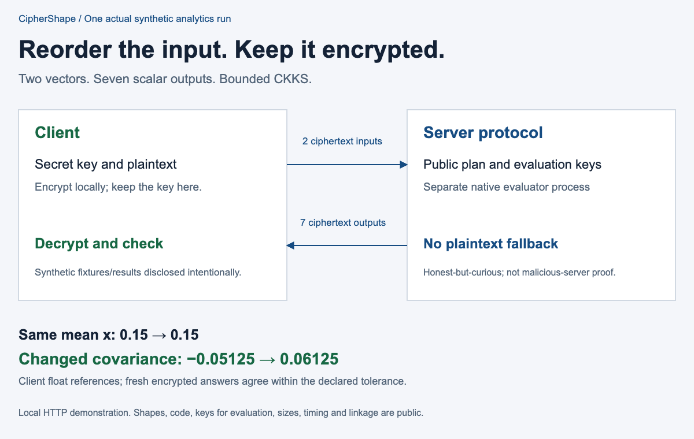
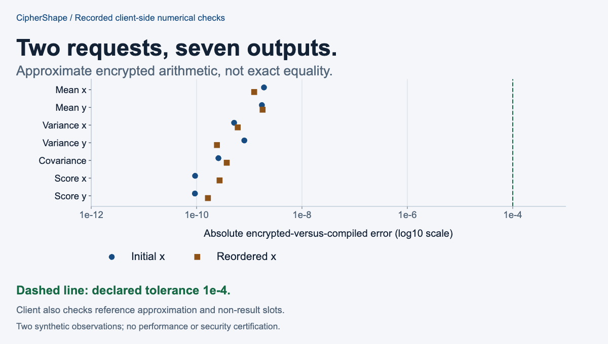

# CipherShape

**Compile bounded numerical endpoints that evaluate encrypted client inputs.**

The client holds the secret key. A separate native server evaluates an OpenFHE CKKS plan and returns encrypted scalar answers, with no plaintext fallback. CipherShape supplies the typed graph, planner, client checks, transport and artifact lifecycle around that execution.

<picture>
  <source media="(max-width: 600px)" srcset="docs/presentation/boundary-mobile.png">
  
</picture>

[Run with the current source and verified Mac workers](#use-the-current-source-with-prebuilt-mac-workers) · [Inspect and reopen the synthetic evidence](docs/presentation/README.md) · [Download the portable reader](https://raw.githubusercontent.com/nazeeh111/CipherShape/3eb4da83fb7e017123db77cdc6b9569d94684a7b/docs/presentation/cipherShape-analytics-reader.zip) · [Security contract](docs/security.md)

## Same values, different relationship

The worked analytics endpoint computes means, population variances, covariance and public weighted scores for two eight-element vectors. Reversing **x** leaves its reference mean **0.15** and variance **0.3** unchanged, while covariance with unchanged **y** moves from **−0.05125** to **0.06125**. The public weighted score of x changes from **0.2390625** to **−0.0703125**.

Two fresh requests crossed the authenticated loopback HTTP boundary and ran in separate native evaluator processes. Both client checks accepted. The largest encrypted-versus-compiled errors were **1.901e−9** and **1.788e−9**; the declared tolerance is **1e−4**, also accounting for reference approximation and checking non-result slots. All fourteen observed output errors appear below. These are two synthetic observations, not an accuracy guarantee or performance study.

<picture>
  <source media="(max-width: 600px)" srcset="docs/presentation/errors-mobile.png">
  
</picture>

The [input vectors](docs/presentation/synthetic-inputs.json), [client report](docs/presentation/analytics-report.json), [boundary observations](docs/presentation/boundary.json) and [refusal controls](docs/presentation/controls.json) are intentionally public synthetic examples. Real inputs, secret keys and decrypted reports belong on the client and should stay private. Re-encrypting the same input produced different ciphertext bytes, as expected from randomized encryption; fresh runs should satisfy the numerical checks rather than reproduce ciphertext hashes.

## What this supports

CKKS provides approximate homomorphic arithmetic for bounded, leveled computations. There is no bootstrapping or arbitrary-depth execution. The server is assumed honest-but-curious and follows the protocol; client numerical checks do not prove correct execution against a malicious server. Public code, weights, shapes, sizes, timing and request linkage remain visible. These local processes are not an operating-system isolation boundary against a malicious host.

The same graph language also supports the retained four-feature **public model inference** example, with public weights trained on original synthetic examples and private feature inputs. It was not retrained or rerun for this analytics walkthrough. The [31-second recorded execution replay](assets/demo/ciphershape-demo.mp4), [raw terminal recording](assets/demo/demo.cast) and [earlier preview](assets/demo/preview.png) remain available. Their edited holds are not latency measurements.

## Use the current source with prebuilt Mac workers

This checkout is **0.1.1.dev0**, an unreleased CLI and artifact-lifecycle successor. The original [v0.1.0 release](https://github.com/nazeeh111/CipherShape/releases/tag/v0.1.0) remains unchanged. Its native workers are compatible with this source; its Python wheel predates the current staging and recovery commands.

Apple silicon, macOS 27.0 or later, and Python 3.11+ are required for the prebuilt workers. Download the [native archive](https://github.com/nazeeh111/CipherShape/releases/download/v0.1.0/ciphershape-native-0.1.0-macos-arm64.tar.gz) into a new empty folder and check its hash against the release's [SHA256SUMS](https://github.com/nazeeh111/CipherShape/releases/download/v0.1.0/SHA256SUMS):

```sh
shasum -a 256 -c <<'SHA256'
dd79b48fa526aaf949384e8040f34e52c8de9efba4be2c7fe09cfa6f2e47b031  ciphershape-native-0.1.0-macos-arm64.tar.gz
SHA256
```

Continue after the archive reports `OK`. These commands install the current Python source and reuse the existing workers without building OpenFHE:

```sh
tar -xzf ciphershape-native-0.1.0-macos-arm64.tar.gz
git clone https://github.com/nazeeh111/CipherShape.git
python3 -m venv .venv
. .venv/bin/activate
python -m pip install ./CipherShape
export CIPHERSHAPE_NATIVE="$PWD/ciphershape-native-0.1.0-macos-arm64/bin"
ciphershape --version
ciphershape demo analytics --out runs/analytics-1
# Optional public-model example:
ciphershape demo model --out runs/model-1
```

`--version` identifies the installed delivery. Choose a new output directory for another run. The source build below remains available for other platforms. The current source was checked with the same digest-verified Mac workers using two fresh synthetic analytics requests over HTTP; both client checks passed. No new model execution, fitting or performance study was used for that check. The earlier standalone release verification used macOS 27.2 and Python 3.13 for both applications.

<details>
<summary>Original v0.1.0 Python release</summary>

The [historical wheel](https://github.com/nazeeh111/CipherShape/releases/download/v0.1.0/ciphershape-0.1.0-py3-none-any.whl) retains SHA-256 `f419b941cb2f53504cc3af490b88f987ba6471d8b3384e0900b087d27630f099`. It can still be installed with `python -m pip install --no-index --no-deps ./ciphershape-0.1.0-py3-none-any.whl`. It does not contain the source successor's lifecycle/recovery behavior or version command. Keep that wheel and its original evidence as a separate delivery.

</details>

## Build and run

Requires Python 3.11+, Git, a C++17 compiler and a Unix-like system. The native
build downloads free OpenFHE source and builds it locally. Allow several minutes
and several GB of temporary disk space. macOS requires the Xcode command-line
tools; Ubuntu CI uses its installed compiler toolchain.

```sh
git clone https://github.com/nazeeh111/CipherShape.git
cd CipherShape
python3 -m venv .venv
. .venv/bin/activate
python -m pip install cmake==3.31.6 pytest==8.4.2 setuptools==80.9.0
python -m pip install --no-build-isolation -e .
python scripts/build_backend.py --jobs 2
export CIPHERSHAPE_NATIVE="$PWD/.runtime/bin"
ciphershape demo analytics --out runs/analytics-1
ciphershape demo model --out runs/model-1
```

Each demo sends two requests with different private inputs over an authenticated
loopback HTTP endpoint. It compares the original float formula, the compiled
plaintext graph and encrypted/decrypted execution. Reports containing answers
stay in `runs/<name>/client/report.json`. Choose a new output directory for
every run. `--transport file` selects the explicit local file protocol instead.

The native dependency is OpenFHE **1.6.1**, pinned to commit
`b59e1f291965f14fbee5172cd83a20f5b856204f`. The build rejects another revision.
The fixed profile is `HEStd_128_classic`, depth 4, 45-bit scale moduli, a 55-bit
first modulus and `FLEXIBLEAUTO`, with ring dimension chosen by OpenFHE.
OpenFHE's numerical kernels are optimized; the small serialization/worker
boundary is compiled at `-O0` to reduce build memory.

The Python wheel contains the frontend, CLI and protocol. Native workers are
built separately. For an ordinary wheel installation, set `CIPHERSHAPE_NATIVE`
to the **absolute directory** containing `ciphershape-client` and
`ciphershape-server`.

## Inspect the client/server boundary

These commands expose the file protocol used below the HTTP demonstration:

```sh
ciphershape compile analytics --public runs/manual/server --private runs/manual/client/private
ciphershape encrypt analytics --public runs/manual/server --private runs/manual/client/private \
  --input examples/analytics-input.json --request runs/manual/request
ciphershape evaluate --public runs/manual/server --request runs/manual/request \
  --response runs/manual/response
ciphershape decrypt --public runs/manual/server --private runs/manual/client/private \
  --request runs/manual/request --response runs/manual/response
```

Only the `evaluate` step belongs on the server. Transfer its public directory
and encrypted request through a trusted or authenticated channel. Keep the
client's private directory, input JSON and decrypted report on the client.
File hashes bind artifacts; they do not authenticate a remote sender. The
included HTTP demonstration binds to `127.0.0.1`, uses an ephemeral owner-scoped
authentication key and returns ciphertexts plus public execution metadata.
It is not a remote deployment service.

## Publish and recover artifacts

Source builds stage each setup, request and response in private sibling
directories, validate the complete file set, and publish without replacing an
existing destination. The linked v0.1.0 wheel predates this lifecycle behavior;
use a source build for these commands until a new wheel is released.

Setup prepares both roots and publishes private first, public last. The public
publication is the commit point. This gives process-failure recovery on supported
local macOS/Linux filesystems, not an atomic transaction across two filesystems
or a power-loss durability guarantee. Parent directories must remain stable.

Before native work starts, the CLI prints the exact private recovery journal on
stderr. Library callers can receive it with the optional `on_prepared` callback.
After an interrupted process exits, recover that single attempt explicitly:

```sh
ciphershape recover --journal /absolute/path/to/stage.json
```

Recovery refuses an active or changed journal, discards an identified unpublished
attempt, and preserves a known published result. If the public output was moved
or replaced and publication cannot be determined, it preserves private output
and the journal for inspection. It never scans for abandoned jobs or deletes by
age or PID. A kill during initial preparation, before a complete journal exists,
can leave a private preparatory directory; automatic recovery does not guess its
ownership. Do not remove changed or unfamiliar paths as a retry shortcut.

Exit `0` means success, `2` means refusal or failure, and `3` means the final
artifacts were published but cleanup needs the named journal. An interruption
returns `130`. Failure receipts contain operation/stage/status and a recovery
path, not key bytes, inputs, decrypted answers or native diagnostics. A failed
demo can retain earlier complete artifact sets; it does not publish a successful
client report. Each new demo still needs a new output directory.

The HTTP route captures and checks outgoing ciphertext bytes before encoding
them. It validates incoming members, digests, request/context binding and typed
server telemetry before publication. Server fields cannot supply the client's
acceptance decision. Python callers should pass `public=public_directory` to
`evaluate_http` to validate the expected output count before publication. Legacy
calls without that argument still check reply/request binding and byte integrity;
their expected output count is checked by `decrypt`. Hashes and telemetry are
consistency evidence, not sender authentication or a proof of performance.

## Declare a workload

```python
from ciphershape.graph import Budget, Workload, dot, private, scale, sum_
from ciphershape.planner import Costs, choose

x = private("samples", 8, bounds=(-1.0, 1.0))
workload = Workload(
    "two_endpoints",
    inputs=(x,),
    outputs=(("mean", scale(sum_(x), 1 / 8)),
             ("score", dot(x, (0.125,) * 8))),
    tolerance=1e-4,
    max_depth=4,
    budget=Budget(requests=10, max_live_bytes=128 * 1024**2),
)
plan, candidates = choose(workload, Costs())
print(plan.text())
```

Supported inputs are public fixed vector shapes, with power-of-two lengths
from 1 through 64. Operations are addition, subtraction, elementwise product,
public scaling/weights and reduction to explicitly named scalar outputs.
Unsupported graphs, excess depth and invalid ranges fail. The graph language
does not execute arbitrary Python or allow secret-dependent branches/indexing.
The `Costs()` defaults are provisional estimates. Load measured costs from the
study before drawing a deployment conclusion.

## Planner and evidence

The planner searches 24 bounded combinations of layout, rotation-key basis,
sharing and retention/recomputation schedule. It prices key setup/upload and
expected requests alongside online work and memory constraints. A small key
basis can save upload bytes while requiring more online rotations. Sharing can
save repeated work while retaining more ciphertexts. See
[planner design and prior art](docs/planner.md).

Run `python -m pytest -q` after building the native workers. Tests cover graph
and plan semantics, authentication, cancellation, changed inputs, boundary and
cancellation-prone values, output masking, wrong keys/epochs, missing rotation
keys, exhausted depth, truncation and payload bounds. Native tests skip when
workers are absent; a frontend-only pass does not verify encryption. The
[CI workflow](.github/workflows/ci.yml) builds both workers and runs both apps.

The [reproduction guide](docs/reproducibility.md) defines the frozen development
and confirmation study, independent installation checks and measured fields.
No speedup is promised. Plaintext is the overhead reference. A matched external
HEIR comparison is currently unavailable. Consult retained execution reports
for results; a plan or configured CI workflow is not a passing release gate.

The [executed local results](docs/results.md) include all eight confirmation
variants and the tight-memory case. Numerical checks pass; a consistent latency
advantage over the tuned baseline was not observed. Both positive and negative
results are retained.

## Limits and ownership

Shapes, weights, code, sizes, timing, counts and request linkage are public.
Returned outputs may themselves reveal input information. This project does
not provide anonymity, differential privacy, hidden-model protection or
malicious-server correctness. Native ciphertext parsing is not made safe
against a malicious owner by envelope checks. A shared laptop does not protect
against an attacker controlling that laptop.

Linux workers apply address-space/allocation limits. The tested macOS
environment does not provide the same hard memory cap; admission checks and
reported process peak memory are used. Details are in the security contract.

Original source, generated examples and model training fixtures use the
[MIT license](LICENSE). OpenFHE retains its BSD 2-Clause license. No external
dataset or pretrained weights are required. The editable
[architecture diagram](docs/architecture.mmd) shows the key boundary.
